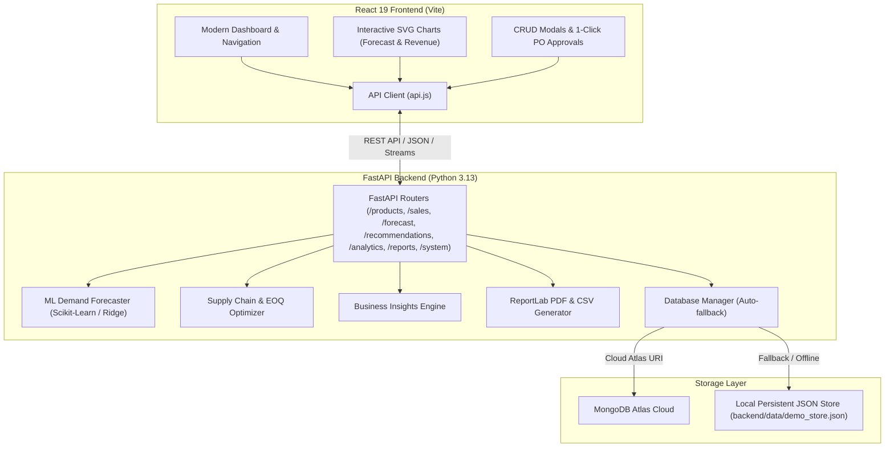

# Business Operations and Intelligence — StockWise AI

[](https://fastapi.tiangolo.com)
[](https://react.dev)
[](https://scikit-learn.org)
[](https://www.mongodb.com/atlas)
[](LICENSE)

**StockWise AI** is an enterprise-grade full-stack AIML business operations and intelligence application. It equips operations managers, procurement officers, and business analysts with real-time inventory management, sales fulfillment tracking, predictive demand forecasting using machine learning, automated Economic Order Quantity (EOQ) reorder recommendations, gross margin analytics, and downloadable CSV/PDF reports.

---

## 🌟 Key Features

1. **Executive Operations Dashboard**
   - Live KPI cards: Total Inventory Asset Value, Total Units, Active SKUs, Low Stock & Critical Alerts, and ML Forecast Accuracy ($R^2$).
   - Interactive SVG demand forecast curves with 95% statistical confidence envelopes.
   - Real-time stock health alerts with direct procurement triggers.
   - Trailing 14-day sales revenue trajectory and top-selling product leaderboard.

2. **Inventory Management & Catalog Control**
   - Full CRUD operations: Create, read, update, and delete products.
   - Dynamic search by SKU, product name, category, and supplier.
   - Real-time stock level stepper (+ / -) directly in the table with immediate backend synchronization.
   - Granular financial tracking: Unit procurement cost, retail price, target inventory ceiling, and total asset valuation.
   - One-click CSV export of the full inventory ledger.

3. **Sales & Order Fulfillment Hub**
   - Customer sales transaction logging over trailing 90 days across multiple channels (Online Store, B2B Direct, Enterprise Wholesale, Retail Outlet).
   - "Record New Sale" modal supporting multi-line items with dynamic stock availability checking.
   - **Automated Inventory Deduction**: Confirmed sales automatically subtract quantities from current inventory in real time.
   - Sales revenue analytics and CSV export.

4. **Machine Learning Demand Forecasting**
   - Predictive time-series regression powered by Scikit-learn (RandomForestRegressor / Ridge ML).
   - Advanced feature engineering: Calendar seasonality (day-of-week, weekend weights, day-of-month), lag features (Lag-1, Lag-7, Lag-14), and 7-day rolling moving averages.
   - Dynamic forecast horizons (7, 14, 30, and 60 days).
   - **Stockout Projection Day**: Calculates exact day inventory will reach zero if unreplenished.
   - Displays statistical evaluation metrics: $R^2$ accuracy score, Mean Absolute Error (MAE), and Root Mean Squared Error (RMSE).

5. **AI Reorder & Supply Chain Optimizer**
   - Implements the classic **Wilson Economic Order Quantity (EOQ)** formula:
     $$\text{EOQ} = \sqrt{\frac{2 \cdot D \cdot S}{H}}$$
     *(where $D$ is annual demand, $S$ is procurement order fee, and $H$ is unit holding cost).*
   - **Stockout Risk Scoring**: Computes risk percentage ($0 - 100\%$) based on days of buffer remaining relative to supplier lead times.
   - Urgency stratification: `CRITICAL`, `HIGH`, `MODERATE`, and `OPTIMAL`.
   - **1-Click Purchase Order Approval**: Instantly creates a Purchase Order (PO) and replenishes stock directly via the backend API.

6. **Business Intelligence & Margin Analytics**
   - **Dead Stock & Idle Capital Audit**: Identifies slow-moving products with capital locked up for over 30 days.
   - **ABC Inventory Classification**: Categorizes products into Class A (top 75% revenue), Class B (next 17%), and Class C (tail 8%).
   - Profitability analysis: Unit cost, retail price, markup %, and gross margin % per SKU.
   - Category asset valuation and unit distribution progress bars.

7. **CSV & PDF Report Generation**
   - **Inventory Master Report (CSV)**: Itemized stock list with procurement costs and thresholds.
   - **Sales Transaction Journal (CSV)**: Trailing order logs and revenue breakdowns.
   - **Executive Intelligence Briefing (PDF)**: Professionally formatted PDF generated on the fly using Python ReportLab with branded headers, KPI summary tables, critical alert tables, and signed model confidence notes.

8. **Resilient Dual-Mode Storage (MongoDB Atlas + Demo Mode)**
   - **MongoDB Atlas Integration**: Connects to cloud MongoDB clusters via standard connection strings.
   - **Zero-Config Demo Mode Fallback**: If `MONGODB_URI` is unconfigured or network is unavailable, the application seamlessly switches to a persistent local JSON repository (`backend/data/demo_store.json`).
   - Mutations (creating products, updating stock, placing orders) persist across server restarts even in demo mode!
   - 1-Click "Reset to Enterprise Sample Baseline" to reload 16 diverse products and ~180 realistic historical transactions.

---

## 🏛 System Architecture



---

## 🚀 Quick Start on Windows

### Option 1: 1-Click Launcher (Recommended)
Simply double-click:
```bat
start_all.bat
```
*(Or run `.\start_all.ps1` in PowerShell).*
This opens the FastAPI backend on port `8000` and the React Vite frontend on port `5173`.

---

### Option 2: Manual Terminal Execution

#### 1. Backend Server Setup
```powershell
# Navigate to backend directory
cd backend

# (Optional) If running for the first time without pre-existing environment:
# python -m venv .venv
# .\.venv\Scripts\Activate.ps1
# pip install -r requirements.txt

# Start backend server
.\.venv\Scripts\python.exe -m uvicorn main:app --host 127.0.0.1 --port 8000 --reload
```
- API Base: `http://127.0.0.1:8000`
- Interactive Swagger Docs: `http://127.0.0.1:8000/docs`

#### 2. Frontend Setup
In a second terminal:
```powershell
cd frontend
npm install
npm run dev
```
Open your browser at: `http://localhost:5173`

---

## 🧪 Running Automated Tests

A comprehensive integration test suite verifies the database manager, CRUD operations, sales fulfillment inventory deductions, ML forecasting algorithms, EOQ reorders, and CSV/PDF streaming:

```powershell
.\backend\.venv\Scripts\python.exe -m pytest backend/tests/test_api.py -v
```

All 12 tests will execute and pass:
```
backend/tests/test_api.py::test_home_and_health_check PASSED
backend/tests/test_api.py::test_system_status PASSED
backend/tests/test_api.py::test_get_products PASSED
backend/tests/test_api.py::test_filter_products PASSED
backend/tests/test_api.py::test_product_stock_adjustment PASSED
backend/tests/test_api.py::test_get_sales PASSED
backend/tests/test_api.py::test_record_sale_and_inventory_deduction PASSED
backend/tests/test_api.py::test_demand_forecasting PASSED
backend/tests/test_api.py::test_reorder_recommendations PASSED
backend/tests/test_api.py::test_approve_reorder_action PASSED
backend/tests/test_api.py::test_analytics_dashboard PASSED
backend/tests/test_api.py::test_reports_csv_and_pdf PASSED
======================== 12 passed in 4.07s ========================
```

---

## ⚙️ Configuration & MongoDB Atlas Setup

You can configure MongoDB Atlas in either of two ways:

### 1. In `backend/.env` file:
```env
MONGODB_URI=mongodb+srv://<username>:<password>@cluster0.abcde.mongodb.net/?retryWrites=true&w=majority
DB_NAME=stockwise_ai
FORCE_DEMO_MODE=false
```

### 2. Live in the UI:
Navigate to the **System & Config** tab in the dashboard, paste your MongoDB Atlas connection string, and click **Connect to MongoDB Atlas**. The application will test the connection, initialize collections with initial enterprise sample data, and activate cloud synchronization immediately.

*(If you leave `MONGODB_URI` blank, StockWise AI operates in offline Demo Mode with complete local persistence).*

---

## 📡 REST API Reference Summary

| Method | Endpoint | Description |
|---|---|---|
| `GET` | `/` | System root and runtime status |
| `GET` | `/api/health` | Health check & database connection diagnostics |
| `GET` | `/api/products` | Query catalog with search, category, and status filters |
| `POST` | `/api/products` | Create new product SKU in catalog |
| `PUT` | `/api/products/{id}` | Update product details and thresholds |
| `DELETE` | `/api/products/{id}` | Remove product from catalog |
| `POST` | `/api/products/{id}/adjust-stock` | Increment or decrement stock quantity |
| `GET` | `/api/sales` | Retrieve historical sales orders |
| `POST` | `/api/sales` | Record customer order & auto-deduct stock |
| `GET` | `/api/sales/top-performers` | Rank products by sales volume & revenue |
| `GET` | `/api/forecast/product/{id}` | ML demand forecast for product (7, 14, 30, 60 days) |
| `GET` | `/api/forecast/aggregate` | Aggregate enterprise demand forecast |
| `GET` | `/api/recommendations` | AI Reorder matrix with EOQ & stockout risk scores |
| `POST` | `/api/recommendations/reorder` | Approve reorder, create PO, and replenish stock |
| `GET` | `/api/analytics/dashboard` | Consolidated executive metrics and KPIs |
| `GET` | `/api/analytics/insights` | Actionable business intelligence signals |
| `GET` | `/api/analytics/revenue-trends` | Trailing revenue velocity timeline |
| `GET` | `/api/reports/inventory/csv` | Download itemized inventory CSV |
| `GET` | `/api/reports/sales/csv` | Download sales transaction journal CSV |
| `GET` | `/api/reports/executive/pdf` | Download formatted executive PDF report |
| `POST` | `/api/system/seed/reset` | Factory reset to enterprise sample dataset |
| `POST` | `/api/system/connect-mongodb` | Test and link MongoDB Atlas cluster |

---

## 👥 Authors & License
Built as part of the **Business Operations and Intelligence — StockWise AI** enterprise initiative. Distributed under the MIT License.
